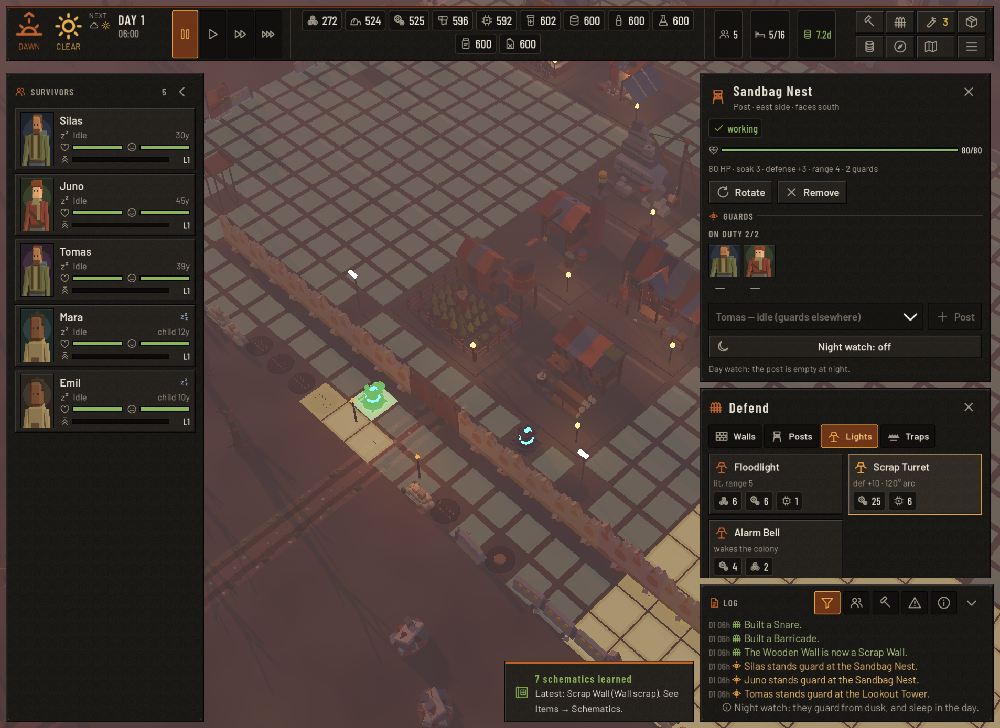
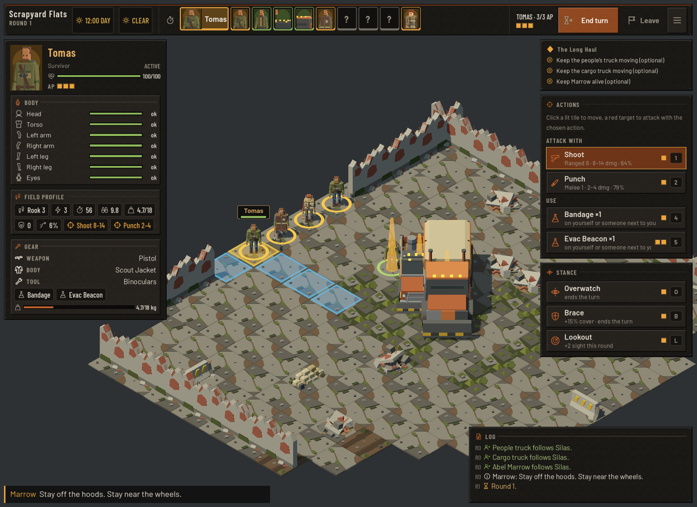
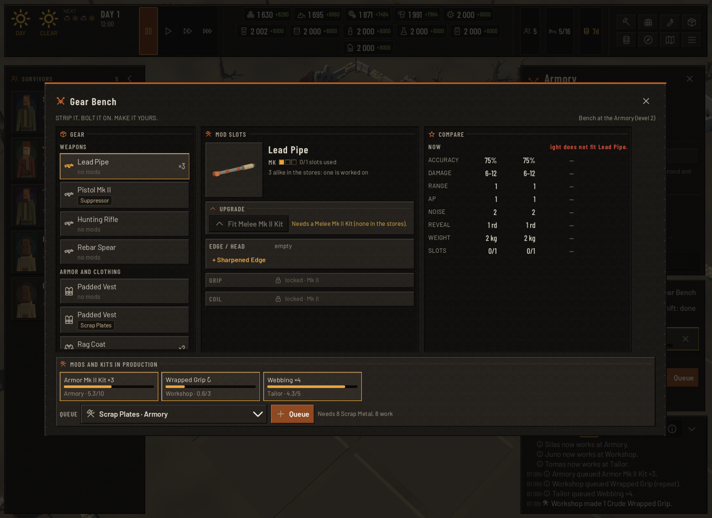

# Missing assets

Generated by `tools/asset-audit/asset_audit.py --write` (also run as a non-failing report by `run-tests.sh`). Do not edit by hand: fix the asset (or the data) and re-run.

Status: **missing** = nothing ships, the game draws a primitive / box / plays nothing; **fallback** = a stand-in asset (lower level scaled, kit piece, generic line icon, neutral mood); **tint** = another model tinted; **placeholder** = synthesised stand-in sound; **silent** = event fired with no sound.

Priority: **high** = seen or heard every session (colony buildings, common items, enemies, UI icons, frequent sounds).

| Category | missing | fallback | tint | placeholder | silent | high |
|---|---:|---:|---:|---:|---:|---:|
| Colony buildings | 0 | 11 | 0 | 0 | 0 | 0 |
| Survivors & characters | 0 | 0 | 0 | 0 | 0 | 0 |
| Enemies | 0 | 0 | 0 | 0 | 0 | 0 |
| Scavenge maps & props | 0 | 0 | 0 | 0 | 0 | 0 |
| Devices & electronics | 0 | 0 | 3 | 0 | 0 | 0 |
| Defenses & traps | 10 | 2 | 3 | 0 | 0 | 0 |
| Gear models | 10 | 0 | 0 | 0 | 0 | 2 |
| Gear mods | 3 | 0 | 0 | 0 | 0 | 0 |
| Cybernetics | 0 | 0 | 0 | 0 | 0 | 0 |
| Vehicles | 2 | 0 | 0 | 0 | 0 | 0 |
| Story portraits | 0 | 45 | 0 | 0 | 0 | 0 |
| Item icons | 0 | 114 | 0 | 0 | 0 | 0 |
| UI icons | 0 | 23 | 0 | 0 | 0 | 2 |
| Sounds | 0 | 0 | 0 | 0 | 0 | 0 |
| Sound events | 0 | 16 | 0 | 0 | 3 | 0 |
| **Total** | 25 | 211 | 6 | 0 | 3 | 4 |

Checked against 492 models, 128 sounds, 466 line icons.

## Screenshots

Captured with `godot-mono --path game -- <flags> --screenshot=...` after a `--headless --import` (a fresh worktree without `.godot/imported` shows every model as a primitive).

`--colony --raid-demo=placement` (taken before the gate, nest, spike strip and first two towers were wired to the shipped `perimeter_*` / `watchtower_l1/_l2` models): the other traps, the floodlight, bell and Fortified Tower are primitive stand-ins (flat trap discs, lamp-post floodlights, bell post); walls are `wall_segment` tinted by tier.

`--scavenge --story-mission=m6` (taken before the fix): Marrow walked as a stock survivor because the code looked up `story_marrow`; story units now go through StoryArt's id table (`story_abel_marrow`, `story_iris_vahn`, `story_doc_hale`). `long_haul_marrow_bike` and `long_haul_tanker` ship but nothing uses them.

`--colony --gear-demo`: every gear row shows its kind's line icon; no rendered item icon (`assets/generated/icons/{id}.png`) ships yet.

## Colony buildings

| Priority | Id | Status | Used in | Should be | Meanwhile |
|---|---|---|---|---|---|
| medium | `armory_l2` | fallback | ModelLibrary.Building, level 2 | Armory (Production) upgraded to level 2 | shows armory_l1 scaled ×1.12 |
| medium | `armory_l3` | fallback | ModelLibrary.Building, level 3 | Armory (Production) upgraded to level 3 | shows armory_l1 scaled ×1.24 |
| medium | `electronics_lab_l2` | fallback | ModelLibrary.Building, level 2 | Electronics Lab (Production) upgraded to level 2 | shows electronics_lab_l1 scaled ×1.12 |
| medium | `electronics_lab_l3` | fallback | ModelLibrary.Building, level 3 | Electronics Lab (Production) upgraded to level 3 | shows electronics_lab_l1 scaled ×1.24 |
| medium | `fuel_still_l2` | fallback | ModelLibrary.Building, level 2 | Biofuel Still (Production) upgraded to level 2 | shows fuel_still_l1 scaled ×1.12 |
| medium | `house_l2` | fallback | ModelLibrary.Building, level 2 | House (Housing) upgraded to level 2 | shows house_l1 scaled ×1.12 |
| medium | `house_l3` | fallback | ModelLibrary.Building, level 3 | House (Housing) upgraded to level 3 | shows house_l1 scaled ×1.24 |
| medium | `kitchen_l2` | fallback | ModelLibrary.Building, level 2 | Kitchen (Care) upgraded to level 2 | shows kitchen_l1 scaled ×1.12 |
| medium | `kitchen_l3` | fallback | ModelLibrary.Building, level 3 | Kitchen (Care) upgraded to level 3 | shows kitchen_l1 scaled ×1.24 |
| medium | `tailor_l2` | fallback | ModelLibrary.Building, level 2 | Tailor (Production) upgraded to level 2 | shows tailor_l1 scaled ×1.12 |
| medium | `tailor_l3` | fallback | ModelLibrary.Building, level 3 | Tailor (Production) upgraded to level 3 | shows tailor_l1 scaled ×1.24 |

## Survivors & characters

Nothing missing.

## Enemies

Nothing missing.

## Scavenge maps & props

Nothing missing.

## Devices & electronics

| Priority | Id | Status | Used in | Should be | Meanwhile |
|---|---|---|---|---|---|
| medium | `cargo_drone` | tint | ScavengeModels.Unit (drone) | cargo drone, rigged like scout_drone | shows scout_drone tinted |
| medium | `combat_drone` | tint | ScavengeModels.Unit (drone) | combat drone, rigged like scout_drone | shows scout_drone tinted |
| medium | `medic_drone` | tint | ScavengeModels.Unit (drone) | medic drone, rigged like scout_drone | shows scout_drone tinted |

## Defenses & traps

| Priority | Id | Status | Used in | Should be | Meanwhile |
|---|---|---|---|---|---|
| medium | `defense_barricade` | fallback | DefenseModels.Build (colony defenses, raids) | Barricade (Barricade): Junk piled high. Cheap, quick, and it buys a moment. | shows cover_low_barrier |
| medium | `defense_defense_turret` | fallback | DefenseModels.Build (colony defenses, raids) | Scrap Turret (Turret): A survivor-made gun on a swivel. Eats scrap for ammo. | shows device_turret |
| medium | `defense_alarm_bell` | missing | DefenseModels.Build (colony defenses, raids) | Alarm Bell (Alarm): Nobody sleeps through it. | draws a primitive stand-in |
| medium | `defense_emp_mine` | missing | DefenseModels.Build (colony defenses, raids) | EMP Mine (Trap): Fries Linked implants and drones in a burst. | draws a primitive stand-in |
| medium | `defense_fire_trap` | missing | DefenseModels.Build (colony defenses, raids) | Fire Trap (Trap): Fuel-soaked brush and a spark. Once. | draws a primitive stand-in |
| medium | `defense_floodlight_post` | missing | DefenseModels.Build (colony defenses, raids) | Floodlight (Light): Lights the approach at night. Husks hear the hum. | draws a primitive stand-in |
| medium | `defense_noise_maker` | missing | DefenseModels.Build (colony defenses, raids) | Noise-maker (Trap): A clockwork rattle that draws Husks away from the walls. | draws a primitive stand-in |
| medium | `defense_pit_trap` | missing | DefenseModels.Build (colony defenses, raids) | Pit Trap (Trap): A covered pit with stakes. Even a Linked falls in. | draws a primitive stand-in |
| medium | `defense_scrap_mine` | missing | DefenseModels.Build (colony defenses, raids) | Scrap Mine (Trap): Nails and a pressure plate. Claymore-style. | draws a primitive stand-in |
| medium | `defense_snare` | missing | DefenseModels.Build (colony defenses, raids) | Snare (Trap): A noose on a sapling. Holds a leg long enough. | draws a primitive stand-in |
| medium | `defense_tripwire_alarm` | missing | DefenseModels.Build (colony defenses, raids) | Tripwire Alarm (Trap): Cans on a wire. An hour's warning, if you are lucky. | draws a primitive stand-in |
| medium | `defense_watchtower_3` | missing | DefenseModels.Build (colony defenses, raids) | Fortified Tower (Tower): Plated and tall: the whole valley in view. | draws a primitive stand-in |
| medium | `defense_wall_concrete` | tint | DefenseModels.Build (colony defenses, raids) | Concrete Wall (Wall): Rubble and cement. It holds. | shows wall_segment tinted by tier |
| medium | `defense_wall_scrap` | tint | DefenseModels.Build (colony defenses, raids) | Scrap Wall (Wall): Car doors and sheet metal over the planks. | shows wall_segment tinted by tier |
| medium | `defense_wall_wood` | tint | DefenseModels.Build (colony defenses, raids) | Wooden Wall (Wall): Planks and posts. Slows anything that wants in. | shows wall_segment tinted by tier |

## Gear models

| Priority | Id | Status | Used in | Should be | Meanwhile |
|---|---|---|---|---|---|
| high | `item_crowbar` | missing | SurvivorDressing.AttachGear, gear bench preview | Crowbar (weapon, tier 1) | not drawn on survivors; bench shows a grey box |
| high | `item_dust_mask` | missing | SurvivorDressing.AttachGear, gear bench preview | Dust Mask & Goggles (headgear, tier 1) | not drawn on survivors; bench shows a grey box |
| medium | `item_pulse_rifle` | missing | SurvivorDressing.AttachGear, gear bench preview | Pulse Rifle (weapon, tier 3) | not drawn on survivors; bench shows a grey box |
| low | `item_crawler_carapace` | missing | SurvivorDressing.AttachGear, gear bench preview | Crawler Carapace (armor, enemy gear) | not drawn on survivors; bench shows a grey box |
| low | `item_crawler_mandibles` | missing | SurvivorDressing.AttachGear, gear bench preview | Crawler Mandibles (weapon, enemy gear) | not drawn on survivors; bench shows a grey box |
| low | `item_drone_zapper` | missing | SurvivorDressing.AttachGear, gear bench preview | Drone Zapper (weapon, enemy gear) | not drawn on survivors; bench shows a grey box |
| low | `item_turret_gun` | missing | SurvivorDressing.AttachGear, gear bench preview | Turret Gun (weapon, enemy gear) | not drawn on survivors; bench shows a grey box |
| low | `item_turret_mount` | missing | SurvivorDressing.AttachGear, gear bench preview | Turret Mount (armor, enemy gear) | not drawn on survivors; bench shows a grey box |
| low | `item_warden_pulse` | missing | SurvivorDressing.AttachGear, gear bench preview | Warden Pulse Cannon (weapon, enemy gear) | not drawn on survivors; bench shows a grey box |
| low | `item_warden_shell` | missing | SurvivorDressing.AttachGear, gear bench preview | Warden Shell (armor, enemy gear) | not drawn on survivors; bench shows a grey box |

## Gear mods

| Priority | Id | Status | Used in | Should be | Meanwhile |
|---|---|---|---|---|---|
| low | `mod_quiet_fabric` | missing | GearModels.ModModel (mod_quiet_fabric) | Quiet Fabric: outer mod for armor/clothing (stealth 4, moveNoise -1) | mod not shown on the gear |
| low | `mod_stab_lining` | missing | GearModels.ModModel (mod_stab_lining) | Stab-proof Lining: lining mod for armor/clothing (meleeArmor 1.5) | mod not shown on the gear |
| low | `mod_thermal_masking` | missing | GearModels.ModModel (mod_thermal_masking) | Thermal Masking: lining mod for armor/clothing (thermalMask 12) | mod not shown on the gear |

## Cybernetics

Nothing missing.

## Vehicles

| Priority | Id | Status | Used in | Should be | Meanwhile |
|---|---|---|---|---|---|
| low | `upgrade:biofuel_conversion` | missing | VehicleDressing (data has no model) | Biofuel Conversion: ×0.6 fuel, ×0.9 speed. | upgrade invisible on the vehicle |
| low | `upgrade:tuned_engine` | missing | VehicleDressing (data has no model) | Tuned Engine: ×1.15 speed, ×1.1 fuel. | upgrade invisible on the vehicle |

## Story portraits

| Priority | Id | Status | Used in | Should be | Meanwhile |
|---|---|---|---|---|---|
| medium | `story_abel_marrow_warm` | fallback | StoryArt.Portrait (12 dialogue lines) | marrow looking warm | shows the neutral portrait |
| medium | `story_cole_brannigan_cold` | fallback | StoryArt.Portrait (14 dialogue lines) | cole looking cold | shows the neutral portrait |
| medium | `story_doc_hale_cold` | fallback | StoryArt.Portrait (11 dialogue lines) | hale looking cold | shows the neutral portrait |
| medium | `story_iris_vahn_cold` | fallback | StoryArt.Portrait (10 dialogue lines) | iris looking cold | shows the neutral portrait |
| medium | `story_iris_vahn_resolved` | fallback | StoryArt.Portrait (18 dialogue lines) | iris looking resolved | shows the neutral portrait |
| medium | `story_iris_vahn_tired` | fallback | StoryArt.Portrait (16 dialogue lines) | iris looking tired | shows the worried portrait |
| medium | `story_iris_vahn_wry` | fallback | StoryArt.Portrait (12 dialogue lines) | iris looking wry | shows the neutral portrait |
| low | `story_abel_marrow_ashamed` | fallback | StoryArt.Portrait (1 dialogue lines) | marrow looking ashamed | shows the worried portrait |
| low | `story_abel_marrow_cold` | fallback | StoryArt.Portrait (3 dialogue lines) | marrow looking cold | shows the neutral portrait |
| low | `story_abel_marrow_grief` | fallback | StoryArt.Portrait (1 dialogue lines) | marrow looking grief | shows the worried portrait |
| low | `story_abel_marrow_resolved` | fallback | StoryArt.Portrait (4 dialogue lines) | marrow looking resolved | shows the neutral portrait |
| low | `story_abel_marrow_tired` | fallback | StoryArt.Portrait (4 dialogue lines) | marrow looking tired | shows the worried portrait |
| low | `story_abel_marrow_wry` | fallback | StoryArt.Portrait (8 dialogue lines) | marrow looking wry | shows the neutral portrait |
| low | `story_cole_brannigan_afraid` | fallback | StoryArt.Portrait (1 dialogue lines) | cole looking afraid | shows the neutral portrait |
| low | `story_cole_brannigan_resolved` | fallback | StoryArt.Portrait (1 dialogue lines) | cole looking resolved | shows the neutral portrait |
| low | `story_cole_brannigan_tired` | fallback | StoryArt.Portrait (1 dialogue lines) | cole looking tired | shows the neutral portrait |
| low | `story_cole_brannigan_warm` | fallback | StoryArt.Portrait (3 dialogue lines) | cole looking warm | shows the neutral portrait |
| low | `story_cole_brannigan_wry` | fallback | StoryArt.Portrait (3 dialogue lines) | cole looking wry | shows the neutral portrait |
| low | `story_dee_cold` | fallback | StoryArt.Portrait (6 dialogue lines) | dee looking cold | shows the neutral portrait |
| low | `story_dee_grief` | fallback | StoryArt.Portrait (1 dialogue lines) | dee looking grief | shows the neutral portrait |
| low | `story_dee_quiet` | fallback | StoryArt.Portrait (1 dialogue lines) | dee looking quiet | shows the neutral portrait |
| low | `story_dee_resolved` | fallback | StoryArt.Portrait (2 dialogue lines) | dee looking resolved | shows the neutral portrait |
| low | `story_dee_wry` | fallback | StoryArt.Portrait (2 dialogue lines) | dee looking wry | shows the neutral portrait |
| low | `story_doc_hale_afraid` | fallback | StoryArt.Portrait (1 dialogue lines) | hale looking afraid | shows the worried portrait |
| low | `story_doc_hale_angry` | fallback | StoryArt.Portrait (1 dialogue lines) | hale looking angry | shows the neutral portrait |
| low | `story_doc_hale_grief` | fallback | StoryArt.Portrait (1 dialogue lines) | hale looking grief | shows the worried portrait |
| low | `story_doc_hale_quiet` | fallback | StoryArt.Portrait (1 dialogue lines) | hale looking quiet | shows the neutral portrait |
| low | `story_doc_hale_resolved` | fallback | StoryArt.Portrait (5 dialogue lines) | hale looking resolved | shows the neutral portrait |
| low | `story_doc_hale_tired` | fallback | StoryArt.Portrait (8 dialogue lines) | hale looking tired | shows the worried portrait |
| low | `story_doc_hale_warm` | fallback | StoryArt.Portrait (5 dialogue lines) | hale looking warm | shows the neutral portrait |
| low | `story_doc_hale_wry` | fallback | StoryArt.Portrait (5 dialogue lines) | hale looking wry | shows the neutral portrait |
| low | `story_iris_vahn_afraid` | fallback | StoryArt.Portrait (7 dialogue lines) | iris looking afraid | shows the worried portrait |
| low | `story_iris_vahn_angry` | fallback | StoryArt.Portrait (1 dialogue lines) | iris looking angry | shows the neutral portrait |
| low | `story_iris_vahn_ashamed` | fallback | StoryArt.Portrait (5 dialogue lines) | iris looking ashamed | shows the worried portrait |
| low | `story_iris_vahn_grief` | fallback | StoryArt.Portrait (7 dialogue lines) | iris looking grief | shows the worried portrait |
| low | `story_iris_vahn_quiet` | fallback | StoryArt.Portrait (9 dialogue lines) | iris looking quiet | shows the neutral portrait |
| low | `story_iris_vahn_warm` | fallback | StoryArt.Portrait (5 dialogue lines) | iris looking warm | shows the neutral portrait |
| low | `story_pell_child_afraid` | fallback | StoryArt.Portrait (8 dialogue lines) | pell looking afraid | shows the worried portrait |
| low | `story_pell_child_resolved` | fallback | StoryArt.Portrait (3 dialogue lines) | pell looking resolved | shows the neutral portrait |
| low | `story_pell_child_tired` | fallback | StoryArt.Portrait (1 dialogue lines) | pell looking tired | shows the worried portrait |
| low | `story_pell_child_warm` | fallback | StoryArt.Portrait (3 dialogue lines) | pell looking warm | shows the neutral portrait |
| low | `story_pell_child_wry` | fallback | StoryArt.Portrait (1 dialogue lines) | pell looking wry | shows the neutral portrait |
| low | `story_seven_dark` | fallback | StoryArt.Portrait (4 dialogue lines) | seven looking dark | shows the neutral portrait |
| low | `story_seven_resolved` | fallback | StoryArt.Portrait (2 dialogue lines) | seven looking resolved | shows the neutral portrait |
| low | `story_seven_warm` | fallback | StoryArt.Portrait (7 dialogue lines) | seven looking warm | shows the neutral portrait |

## Item icons

| Priority | Id | Status | Used in | Should be | Meanwhile |
|---|---|---|---|---|---|
| medium | `icons/antidote.png` | fallback | Icons.Item (inventory, loot, trade, bench, expedition) | Antidote, rendered consumable icon | shows the item_consumable line icon |
| medium | `icons/antiseptic.png` | fallback | Icons.Item (inventory, loot, trade, bench, expedition) | Antiseptic, rendered consumable icon | shows the item_consumable line icon |
| medium | `icons/backpack.png` | fallback | Icons.Item (inventory, loot, trade, bench, expedition) | Backpack, rendered tool icon | shows the item_tool line icon |
| medium | `icons/bandage.png` | fallback | Icons.Item (inventory, loot, trade, bench, expedition) | Bandage, rendered consumable icon | shows the item_consumable line icon |
| medium | `icons/chemical_jug.png` | fallback | Icons.Item (inventory, loot, trade, bench, expedition) | Chemical Jug, rendered material icon | shows the item_material line icon |
| medium | `icons/clean_dressing.png` | fallback | Icons.Item (inventory, loot, trade, bench, expedition) | Clean Dressing, rendered consumable icon | shows the item_consumable line icon |
| medium | `icons/climbing_gear.png` | fallback | Icons.Item (inventory, loot, trade, bench, expedition) | Climbing Gear, rendered tool icon | shows the item_tool line icon |
| medium | `icons/cloth.png` | fallback | Icons.Item (inventory, loot, trade, bench, expedition) | Cloth, rendered material icon | shows the item_material line icon |
| medium | `icons/concrete_chunk.png` | fallback | Icons.Item (inventory, loot, trade, bench, expedition) | Concrete Chunk, rendered material icon | shows the item_material line icon |
| medium | `icons/crowbar.png` | fallback | Icons.Item (inventory, loot, trade, bench, expedition) | Crowbar, rendered weapon icon | shows the item_weapon line icon |
| medium | `icons/data_shard.png` | fallback | Icons.Item (inventory, loot, trade, bench, expedition) | Data Shard, rendered material icon | shows the item_material line icon |
| medium | `icons/dust_mask.png` | fallback | Icons.Item (inventory, loot, trade, bench, expedition) | Dust Mask & Goggles, rendered headgear icon | shows the item_headgear line icon |
| medium | `icons/electronics.png` | fallback | Icons.Item (inventory, loot, trade, bench, expedition) | Electronics, rendered material icon | shows the item_material line icon |
| medium | `icons/flare.png` | fallback | Icons.Item (inventory, loot, trade, bench, expedition) | Flare, rendered consumable icon | shows the item_consumable line icon |
| medium | `icons/fuel_can.png` | fallback | Icons.Item (inventory, loot, trade, bench, expedition) | Fuel Can, rendered material icon | shows the item_material line icon |
| medium | `icons/hand_saw.png` | fallback | Icons.Item (inventory, loot, trade, bench, expedition) | Hand Saw, rendered material icon | shows the item_material line icon |
| medium | `icons/hook_arm.png` | fallback | Icons.Item (inventory, loot, trade, bench, expedition) | Hook Arm, rendered prosthetic icon | shows the item_prosthetic line icon |
| medium | `icons/machete.png` | fallback | Icons.Item (inventory, loot, trade, bench, expedition) | Machete, rendered weapon icon | shows the item_weapon line icon |
| medium | `icons/manual_electronics.png` | fallback | Icons.Item (inventory, loot, trade, bench, expedition) | Field Manual: Electronics, rendered material icon | shows the item_material line icon |
| medium | `icons/marrow_ledger.png` | fallback | Icons.Item (inventory, loot, trade, bench, expedition) | Marrow's Ledger, rendered material icon | shows the item_material line icon |
| medium | `icons/mech_arm.png` | fallback | Icons.Item (inventory, loot, trade, bench, expedition) | Mechanical Arm, rendered prosthetic icon | shows the item_prosthetic line icon |
| medium | `icons/mech_leg.png` | fallback | Icons.Item (inventory, loot, trade, bench, expedition) | Mechanical Leg, rendered prosthetic icon | shows the item_prosthetic line icon |
| medium | `icons/med_kit.png` | fallback | Icons.Item (inventory, loot, trade, bench, expedition) | Med-kit, rendered consumable icon | shows the item_consumable line icon |
| medium | `icons/med_supplies.png` | fallback | Icons.Item (inventory, loot, trade, bench, expedition) | Medical Supplies, rendered material icon | shows the item_material line icon |
| medium | `icons/padded_vest.png` | fallback | Icons.Item (inventory, loot, trade, bench, expedition) | Padded Vest, rendered armor icon | shows the item_armor line icon |
| medium | `icons/painkiller.png` | fallback | Icons.Item (inventory, loot, trade, bench, expedition) | Painkillers, rendered consumable icon | shows the item_consumable line icon |
| medium | `icons/peg_leg.png` | fallback | Icons.Item (inventory, loot, trade, bench, expedition) | Peg Leg, rendered prosthetic icon | shows the item_prosthetic line icon |
| medium | `icons/pickaxe.png` | fallback | Icons.Item (inventory, loot, trade, bench, expedition) | Pickaxe, rendered material icon | shows the item_material line icon |
| medium | `icons/pipe.png` | fallback | Icons.Item (inventory, loot, trade, bench, expedition) | Lead Pipe, rendered weapon icon | shows the item_weapon line icon |
| medium | `icons/rag_coat.png` | fallback | Icons.Item (inventory, loot, trade, bench, expedition) | Rag Coat, rendered clothing icon | shows the item_clothing line icon |
| medium | `icons/relay_antenna.png` | fallback | Icons.Item (inventory, loot, trade, bench, expedition) | Relay Antenna, rendered material icon | shows the item_material line icon |
| medium | `icons/scrap.png` | fallback | Icons.Item (inventory, loot, trade, bench, expedition) | Scrap, rendered material icon | shows the item_material line icon |
| medium | `icons/servo.png` | fallback | Icons.Item (inventory, loot, trade, bench, expedition) | Servo, rendered material icon | shows the item_material line icon |
| medium | `icons/spare_parts.png` | fallback | Icons.Item (inventory, loot, trade, bench, expedition) | Spare Parts, rendered material icon | shows the item_material line icon |
| medium | `icons/spear.png` | fallback | Icons.Item (inventory, loot, trade, bench, expedition) | Rebar Spear, rendered weapon icon | shows the item_weapon line icon |
| medium | `icons/splint.png` | fallback | Icons.Item (inventory, loot, trade, bench, expedition) | Splint, rendered consumable icon | shows the item_consumable line icon |
| medium | `icons/stone.png` | fallback | Icons.Item (inventory, loot, trade, bench, expedition) | Stone Blocks, rendered material icon | shows the item_material line icon |
| medium | `icons/suture_kit.png` | fallback | Icons.Item (inventory, loot, trade, bench, expedition) | Suture Kit, rendered consumable icon | shows the item_consumable line icon |
| medium | `icons/trade_crate.png` | fallback | Icons.Item (inventory, loot, trade, bench, expedition) | Trade Crate, rendered material icon | shows the item_material line icon |
| medium | `icons/wheel.png` | fallback | Icons.Item (inventory, loot, trade, bench, expedition) | Wheel, rendered material icon | shows the item_material line icon |
| medium | `icons/wood.png` | fallback | Icons.Item (inventory, loot, trade, bench, expedition) | Salvaged Wood, rendered material icon | shows the item_material line icon |
| low | `icons/antibiotics.png` | fallback | Icons.Item (inventory, loot, trade, bench, expedition) | Antibiotics, rendered consumable icon | shows the item_consumable line icon |
| low | `icons/armor_plate.png` | fallback | Icons.Item (inventory, loot, trade, bench, expedition) | Armor Plate, rendered material icon | shows the item_material line icon |
| low | `icons/armored_leg.png` | fallback | Icons.Item (inventory, loot, trade, bench, expedition) | Armored Leg, rendered prosthetic icon | shows the item_prosthetic line icon |
| low | `icons/armored_leg_mk2.png` | fallback | Icons.Item (inventory, loot, trade, bench, expedition) | Cyborg Armored Leg, rendered prosthetic icon | shows the item_prosthetic line icon |
| low | `icons/binoculars.png` | fallback | Icons.Item (inventory, loot, trade, bench, expedition) | Binoculars, rendered tool icon | shows the item_tool line icon |
| low | `icons/blade_arm.png` | fallback | Icons.Item (inventory, loot, trade, bench, expedition) | Blade Arm, rendered prosthetic icon | shows the item_prosthetic line icon |
| low | `icons/blade_arm_mk2.png` | fallback | Icons.Item (inventory, loot, trade, bench, expedition) | Cyborg Blade Arm, rendered prosthetic icon | shows the item_prosthetic line icon |
| low | `icons/blood_bag.png` | fallback | Icons.Item (inventory, loot, trade, bench, expedition) | Blood Bag, rendered consumable icon | shows the item_consumable line icon |
| low | `icons/calm_injector.png` | fallback | Icons.Item (inventory, loot, trade, bench, expedition) | Linked "Calm" Injector, rendered consumable icon | shows the item_consumable line icon |
| low | `icons/camera_lens.png` | fallback | Icons.Item (inventory, loot, trade, bench, expedition) | Camera Lens, rendered tool icon (enemy gear) | shows the item_tool line icon |
| low | `icons/camo_cloak.png` | fallback | Icons.Item (inventory, loot, trade, bench, expedition) | Camo Cloak, rendered clothing icon | shows the item_clothing line icon |
| low | `icons/chassis_frame.png` | fallback | Icons.Item (inventory, loot, trade, bench, expedition) | Chassis Frame, rendered material icon | shows the item_material line icon |
| low | `icons/cole_ledger.png` | fallback | Icons.Item (inventory, loot, trade, bench, expedition) | The Tally's List, rendered material icon | shows the item_material line icon |
| low | `icons/crawler_carapace.png` | fallback | Icons.Item (inventory, loot, trade, bench, expedition) | Crawler Carapace, rendered armor icon (enemy gear) | shows the item_armor line icon |
| low | `icons/crawler_mandibles.png` | fallback | Icons.Item (inventory, loot, trade, bench, expedition) | Crawler Mandibles, rendered weapon icon (enemy gear) | shows the item_weapon line icon |
| low | `icons/cyber_arm.png` | fallback | Icons.Item (inventory, loot, trade, bench, expedition) | Cybernetic Arm, rendered prosthetic icon | shows the item_prosthetic line icon |
| low | `icons/cyber_leg.png` | fallback | Icons.Item (inventory, loot, trade, bench, expedition) | Cybernetic Leg, rendered prosthetic icon | shows the item_prosthetic line icon |
| low | `icons/cyberdeck.png` | fallback | Icons.Item (inventory, loot, trade, bench, expedition) | Cyberdeck, rendered tool icon | shows the item_tool line icon |
| low | `icons/diesel_engine.png` | fallback | Icons.Item (inventory, loot, trade, bench, expedition) | Freight Diesel Engine, rendered material icon | shows the item_material line icon |
| low | `icons/drone_core.png` | fallback | Icons.Item (inventory, loot, trade, bench, expedition) | Drone Core, rendered material icon | shows the item_material line icon |
| low | `icons/drone_frame.png` | fallback | Icons.Item (inventory, loot, trade, bench, expedition) | Drone Frame, rendered tool icon (enemy gear) | shows the item_tool line icon |
| low | `icons/drone_parts.png` | fallback | Icons.Item (inventory, loot, trade, bench, expedition) | Drone Parts, rendered material icon | shows the item_material line icon |
| low | `icons/drone_rotors.png` | fallback | Icons.Item (inventory, loot, trade, bench, expedition) | Drone Rotors, rendered tool icon (enemy gear) | shows the item_tool line icon |
| low | `icons/drone_zapper.png` | fallback | Icons.Item (inventory, loot, trade, bench, expedition) | Drone Zapper, rendered weapon icon (enemy gear) | shows the item_weapon line icon |
| low | `icons/engine_small.png` | fallback | Icons.Item (inventory, loot, trade, bench, expedition) | Small Engine, rendered material icon | shows the item_material line icon |
| low | `icons/engine_v8.png` | fallback | Icons.Item (inventory, loot, trade, bench, expedition) | Freight Diesel, rendered material icon | shows the item_material line icon |
| low | `icons/evac_beacon.png` | fallback | Icons.Item (inventory, loot, trade, bench, expedition) | Evac Beacon, rendered consumable icon | shows the item_consumable line icon |
| low | `icons/grappling_hook.png` | fallback | Icons.Item (inventory, loot, trade, bench, expedition) | Grappling Hook, rendered tool icon | shows the item_tool line icon |
| low | `icons/gun_arm.png` | fallback | Icons.Item (inventory, loot, trade, bench, expedition) | Gun Arm, rendered prosthetic icon | shows the item_prosthetic line icon |
| low | `icons/hacker_arm.png` | fallback | Icons.Item (inventory, loot, trade, bench, expedition) | Hacker Arm, rendered prosthetic icon | shows the item_prosthetic line icon |
| low | `icons/hacking_kit.png` | fallback | Icons.Item (inventory, loot, trade, bench, expedition) | Hacking Kit, rendered tool icon | shows the item_tool line icon |
| low | `icons/husk_claws.png` | fallback | Icons.Item (inventory, loot, trade, bench, expedition) | Husk Claws, rendered weapon icon (enemy gear) | shows the item_weapon line icon |
| low | `icons/jumper_leg.png` | fallback | Icons.Item (inventory, loot, trade, bench, expedition) | Jumper Leg, rendered prosthetic icon | shows the item_prosthetic line icon |
| low | `icons/labor_arm.png` | fallback | Icons.Item (inventory, loot, trade, bench, expedition) | Labor Arm, rendered prosthetic icon | shows the item_prosthetic line icon |
| low | `icons/labor_arm_mk2.png` | fallback | Icons.Item (inventory, loot, trade, bench, expedition) | Cyborg Labor Arm, rendered prosthetic icon | shows the item_prosthetic line icon |
| low | `icons/linked_biogel.png` | fallback | Icons.Item (inventory, loot, trade, bench, expedition) | Linked Bio-gel, rendered material icon | shows the item_material line icon |
| low | `icons/linked_carbine.png` | fallback | Icons.Item (inventory, loot, trade, bench, expedition) | Linked Carbine, rendered weapon icon | shows the item_weapon line icon |
| low | `icons/linked_core.png` | fallback | Icons.Item (inventory, loot, trade, bench, expedition) | Linked Core, rendered material icon | shows the item_material line icon |
| low | `icons/linked_plating.png` | fallback | Icons.Item (inventory, loot, trade, bench, expedition) | Linked Plating, rendered armor icon | shows the item_armor line icon |
| low | `icons/manual_drone_ops.png` | fallback | Icons.Item (inventory, loot, trade, bench, expedition) | Field Manual: Drone Ops, rendered material icon | shows the item_material line icon |
| low | `icons/manual_intrusion.png` | fallback | Icons.Item (inventory, loot, trade, bench, expedition) | Field Manual: Intrusion, rendered material icon | shows the item_material line icon |
| low | `icons/motion_sensor.png` | fallback | Icons.Item (inventory, loot, trade, bench, expedition) | Motion Sensor, rendered consumable icon | shows the item_consumable line icon |
| low | `icons/myomer_bundle.png` | fallback | Icons.Item (inventory, loot, trade, bench, expedition) | Myomer Bundle, rendered material icon | shows the item_material line icon |
| low | `icons/network_arm.png` | fallback | Icons.Item (inventory, loot, trade, bench, expedition) | Network-grade Arm, rendered prosthetic icon | shows the item_prosthetic line icon |
| low | `icons/network_eye.png` | fallback | Icons.Item (inventory, loot, trade, bench, expedition) | Network-grade Eye, rendered prosthetic icon | shows the item_prosthetic line icon |
| low | `icons/network_leg.png` | fallback | Icons.Item (inventory, loot, trade, bench, expedition) | Network-grade Leg, rendered prosthetic icon | shows the item_prosthetic line icon |
| low | `icons/neural_link.png` | fallback | Icons.Item (inventory, loot, trade, bench, expedition) | Neural Link, rendered material icon | shows the item_material line icon |
| low | `icons/pharma_stash.png` | fallback | Icons.Item (inventory, loot, trade, bench, expedition) | Salvaged Pharma, rendered material icon | shows the item_material line icon |
| low | `icons/pistol.png` | fallback | Icons.Item (inventory, loot, trade, bench, expedition) | Pistol, rendered weapon icon | shows the item_weapon line icon |
| low | `icons/power_cell.png` | fallback | Icons.Item (inventory, loot, trade, bench, expedition) | Power Cell, rendered material icon | shows the item_material line icon |
| low | `icons/precision_arm.png` | fallback | Icons.Item (inventory, loot, trade, bench, expedition) | Precision Arm, rendered prosthetic icon | shows the item_prosthetic line icon |
| low | `icons/precision_arm_mk2.png` | fallback | Icons.Item (inventory, loot, trade, bench, expedition) | Cyborg Precision Arm, rendered prosthetic icon | shows the item_prosthetic line icon |
| low | `icons/pulse_rifle.png` | fallback | Icons.Item (inventory, loot, trade, bench, expedition) | Pulse Rifle, rendered weapon icon | shows the item_weapon line icon |
| low | `icons/rifle.png` | fallback | Icons.Item (inventory, loot, trade, bench, expedition) | Hunting Rifle, rendered weapon icon | shows the item_weapon line icon |
| low | `icons/riot_armor.png` | fallback | Icons.Item (inventory, loot, trade, bench, expedition) | Riot Armor, rendered armor icon | shows the item_armor line icon |
| low | `icons/runner_leg.png` | fallback | Icons.Item (inventory, loot, trade, bench, expedition) | Runner Leg, rendered prosthetic icon | shows the item_prosthetic line icon |
| low | `icons/runner_leg_mk2.png` | fallback | Icons.Item (inventory, loot, trade, bench, expedition) | Cyborg Runner Leg, rendered prosthetic icon | shows the item_prosthetic line icon |
| low | `icons/scanner.png` | fallback | Icons.Item (inventory, loot, trade, bench, expedition) | Scanner, rendered tool icon | shows the item_tool line icon |
| low | `icons/scope_eye.png` | fallback | Icons.Item (inventory, loot, trade, bench, expedition) | Scope Eye, rendered prosthetic icon | shows the item_prosthetic line icon |
| low | `icons/scout_drone.png` | fallback | Icons.Item (inventory, loot, trade, bench, expedition) | Scout Drone, rendered tool icon | shows the item_tool line icon |
| low | `icons/scout_jacket.png` | fallback | Icons.Item (inventory, loot, trade, bench, expedition) | Scout Jacket, rendered clothing icon | shows the item_clothing line icon |
| low | `icons/servo_arm.png` | fallback | Icons.Item (inventory, loot, trade, bench, expedition) | Servo Arm, rendered prosthetic icon | shows the item_prosthetic line icon |
| low | `icons/signal_jammer.png` | fallback | Icons.Item (inventory, loot, trade, bench, expedition) | Signal Jammer, rendered tool icon | shows the item_tool line icon |
| low | `icons/silent_leg.png` | fallback | Icons.Item (inventory, loot, trade, bench, expedition) | Silent Leg, rendered prosthetic icon | shows the item_prosthetic line icon |
| low | `icons/silent_leg_mk2.png` | fallback | Icons.Item (inventory, loot, trade, bench, expedition) | Cyborg Silent Leg, rendered prosthetic icon | shows the item_prosthetic line icon |
| low | `icons/stim.png` | fallback | Icons.Item (inventory, loot, trade, bench, expedition) | Combat Stim, rendered consumable icon | shows the item_consumable line icon |
| low | `icons/surgical_kit.png` | fallback | Icons.Item (inventory, loot, trade, bench, expedition) | Surgical Kit, rendered material icon | shows the item_material line icon |
| low | `icons/thermal_eye.png` | fallback | Icons.Item (inventory, loot, trade, bench, expedition) | Thermal Eye, rendered prosthetic icon | shows the item_prosthetic line icon |
| low | `icons/trauma_kit.png` | fallback | Icons.Item (inventory, loot, trade, bench, expedition) | Field Trauma Kit, rendered consumable icon | shows the item_consumable line icon |
| low | `icons/turret_gun.png` | fallback | Icons.Item (inventory, loot, trade, bench, expedition) | Turret Gun, rendered weapon icon (enemy gear) | shows the item_weapon line icon |
| low | `icons/turret_mount.png` | fallback | Icons.Item (inventory, loot, trade, bench, expedition) | Turret Mount, rendered armor icon (enemy gear) | shows the item_armor line icon |
| low | `icons/warden_pulse.png` | fallback | Icons.Item (inventory, loot, trade, bench, expedition) | Warden Pulse Cannon, rendered weapon icon (enemy gear) | shows the item_weapon line icon |
| low | `icons/warden_shell.png` | fallback | Icons.Item (inventory, loot, trade, bench, expedition) | Warden Shell, rendered armor icon (enemy gear) | shows the item_armor line icon |

## UI icons

| Priority | Id | Status | Used in | Should be | Meanwhile |
|---|---|---|---|---|---|
| high | `bld_watchtower` | fallback | Icons.Building (build menu, building panel) | line icon for Watchtower | shows bld_cat_core |
| high | `item_headgear` | fallback | Icons.Item kind line icon | line icon for Headgear items | shows body_head |
| medium | `body_eyes` | fallback | Icons.BodyPart | Eyes body part | shows body_full |
| low | `def_alarm_bell` | fallback | RaidText.Icon (defense catalog, panel) | line icon for Alarm Bell | shows def_cat_ icon |
| low | `def_barricade` | fallback | RaidText.Icon (defense catalog, panel) | line icon for Barricade | shows def_cat_ icon |
| low | `def_defense_turret` | fallback | RaidText.Icon (defense catalog, panel) | line icon for Scrap Turret | shows def_cat_ icon |
| low | `def_emp_mine` | fallback | RaidText.Icon (defense catalog, panel) | line icon for EMP Mine | shows def_cat_ icon |
| low | `def_fire_trap` | fallback | RaidText.Icon (defense catalog, panel) | line icon for Fire Trap | shows def_cat_ icon |
| low | `def_floodlight_post` | fallback | RaidText.Icon (defense catalog, panel) | line icon for Floodlight | shows def_cat_ icon |
| low | `def_gate_wood` | fallback | RaidText.Icon (defense catalog, panel) | line icon for Gate | shows def_cat_ icon |
| low | `def_noise_maker` | fallback | RaidText.Icon (defense catalog, panel) | line icon for Noise-maker | shows def_cat_ icon |
| low | `def_pit_trap` | fallback | RaidText.Icon (defense catalog, panel) | line icon for Pit Trap | shows def_cat_ icon |
| low | `def_sandbag_nest` | fallback | RaidText.Icon (defense catalog, panel) | line icon for Sandbag Nest | shows def_cat_ icon |
| low | `def_scrap_mine` | fallback | RaidText.Icon (defense catalog, panel) | line icon for Scrap Mine | shows def_cat_ icon |
| low | `def_snare` | fallback | RaidText.Icon (defense catalog, panel) | line icon for Snare | shows def_cat_ icon |
| low | `def_spike_strip` | fallback | RaidText.Icon (defense catalog, panel) | line icon for Spike Strip | shows def_cat_ icon |
| low | `def_tripwire_alarm` | fallback | RaidText.Icon (defense catalog, panel) | line icon for Tripwire Alarm | shows def_cat_ icon |
| low | `def_wall_concrete` | fallback | RaidText.Icon (defense catalog, panel) | line icon for Concrete Wall | shows def_cat_ icon |
| low | `def_wall_scrap` | fallback | RaidText.Icon (defense catalog, panel) | line icon for Scrap Wall | shows def_cat_ icon |
| low | `def_wall_wood` | fallback | RaidText.Icon (defense catalog, panel) | line icon for Wooden Wall | shows def_cat_ icon |
| low | `def_watchtower_1` | fallback | RaidText.Icon (defense catalog, panel) | line icon for Lookout Tower | shows def_cat_ icon |
| low | `def_watchtower_2` | fallback | RaidText.Icon (defense catalog, panel) | line icon for Watchtower | shows def_cat_ icon |
| low | `def_watchtower_3` | fallback | RaidText.Icon (defense catalog, panel) | line icon for Fortified Tower | shows def_cat_ icon |

## Sounds

Nothing missing.

## Sound events

| Priority | Id | Status | Used in | Should be | Meanwhile |
|---|---|---|---|---|---|
| medium | `scavenge.died.cole` | fallback | ScavengeAudio.EventNames | died sound of a cole | plays generic scavenge.died |
| medium | `scavenge.died.husk` | fallback | ScavengeAudio.EventNames | died sound of a husk | plays generic scavenge.died |
| medium | `scavenge.died.husk_crawler` | fallback | ScavengeAudio.EventNames | died sound of a husk_crawler | plays generic scavenge.died |
| medium | `scavenge.died.tally_blade` | fallback | ScavengeAudio.EventNames | died sound of a tally_blade | plays generic scavenge.died |
| medium | `scavenge.died.tally_scav` | fallback | ScavengeAudio.EventNames | died sound of a tally_scav | plays generic scavenge.died |
| medium | `scavenge.hit.cole` | fallback | ScavengeAudio.EventNames (hit) | hit sound of a cole | plays generic scavenge.hit |
| medium | `scavenge.hit.husk` | fallback | ScavengeAudio.EventNames (hit) | hit sound of a husk | plays generic scavenge.hit |
| medium | `scavenge.hit.husk_crawler` | fallback | ScavengeAudio.EventNames (hit) | hit sound of a husk_crawler | plays generic scavenge.hit |
| medium | `scavenge.hit.tally_blade` | fallback | ScavengeAudio.EventNames (hit) | hit sound of a tally_blade | plays generic scavenge.hit |
| medium | `scavenge.hit.tally_scav` | fallback | ScavengeAudio.EventNames (hit) | hit sound of a tally_scav | plays generic scavenge.hit |
| low | `scavenge.bark.cole` | fallback | ScavengeAudio.EventNames (enemy bark) | bark sound of a cole | plays generic scavenge.bark |
| low | `scavenge.bark.husk` | fallback | ScavengeAudio.EventNames (enemy bark) | bark sound of a husk | plays generic scavenge.bark |
| low | `scavenge.bark.husk_crawler` | fallback | ScavengeAudio.EventNames (enemy bark) | bark sound of a husk_crawler | plays generic scavenge.bark |
| low | `scavenge.bark.tally_blade` | fallback | ScavengeAudio.EventNames (enemy bark) | bark sound of a tally_blade | plays generic scavenge.bark |
| low | `scavenge.bark.tally_scav` | fallback | ScavengeAudio.EventNames (enemy bark) | bark sound of a tally_scav | plays generic scavenge.bark |
| low | `scavenge.moved.linked_drone` | fallback | ScavengeAudio.EventNames | moved sound of a linked_drone | silent via scavenge.moved [] |
| low | `scavenge.attack.unseen` | silent | ScavengeAudio.EventNames | mapped to [] (deliberately silent) | review: frequent event with no sound |
| low | `scavenge.moved.linked_warden` | silent | ScavengeAudio.EventNames | mapped to [] (deliberately silent) | review: frequent event with no sound |
| low | `scavenge.overwatch` | silent | ScavengeAudio.EventNames | mapped to [] (deliberately silent) | review: frequent event with no sound |

